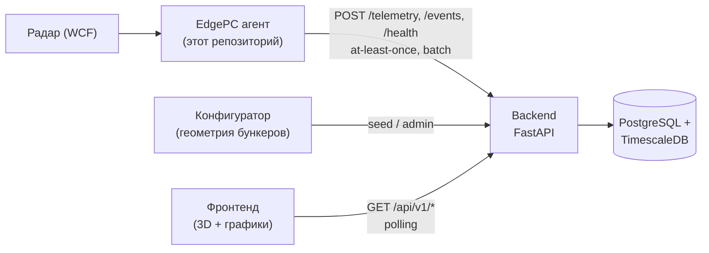
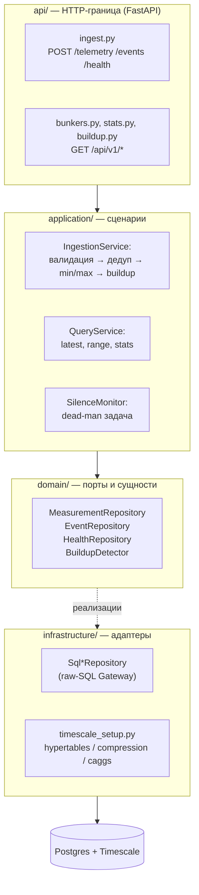

# Backend демо — план до конца месяца

> **Статус:** черновик для обсуждения. **Дата:** 2026-08-25. **Окно демо:** до 31.08.
>
> Этот документ описывает **серверную часть** системы мониторинга бункеров — то,
> чего пока нет в виде кода. Агент EdgePC (этот репозиторий) уже спроектирован в
> [`implementation-guide.md`](implementation-guide.md); здесь фиксируется вторая
> половина системы: приём телеметрии, хранение временных рядов и API для фронта.
>
> Документ отвечает на три вопроса: **с чего начать**, **чем закончить** и
> **где подводные камни** (в первую очередь — лаги фронта на больших данных и
> переход на TimescaleDB).

<a id="contents"></a>
## Оглавление

- [1. Контекст и границы демо](#context)
- [2. Стек технологий](#stack)
- [3. Архитектура и структура проекта](#structure)
- [4. Модель данных и Timescale-ready хранение](#data-model)
- [5. Блоки бэкенда](#blocks)
  - [A. Ingestion API — приём от EdgePC](#block-ingestion)
  - [B. Query API — отдача фронту](#block-query)
  - [C. Слой данных: репозитории и raw-SQL Gateway](#block-storage)
  - [D. Агрегации и статистика](#block-stats)
  - [E. Детектор buildup](#block-buildup)
  - [F. Health edge и алерт по тишине](#block-silence)
  - [G. Безопасность: токен edge и CORS](#block-security)
  - [H. Наблюдаемость, деплой и сидинг](#block-ops)
- [6. План работ по дням (25–31 августа)](#plan)
- [7. Риски и проблемы](#risks)
  - [7.1 Главный риск: лаги фронта на больших данных](#risk-lag)
  - [7.2 Обычная БД против временных рядов](#risk-tsdb)
  - [7.3 Остальные риски (таблица)](#risk-table)
- [8. Ответы на вопросы](#answers)
  - [Придётся ли редактировать фронтенд?](#answer-frontend)
  - [Что тогда будет в бэкенде?](#answer-backend-content)
- [9. Общий список ссылок](#links)
- [10. Статус реализации и осознанные отклонения](#implementation-status)

---

<a id="context"></a>
## 1. Контекст и границы демо

### Система целиком



Ключевое следствие из архитектуры edge: **сервер — единственный потребитель
outbox-потока**. Edge доставляет данные at-least-once, значит сервер обязан
гасить дубли по `bunker_id + event_id` (контракт зафиксирован в
[фазе 7а](implementation-guide.md#phase-7a)).

### Цель демо

За одну сессию показать живую цепочку: **радар/мок → edge → сервер → фронт**,
где фронт читает данные из настоящей БД с временными рядами, а не из
in-memory мока.

### Что входит в демо (MoSCoW)

| Приоритет | Функция |
| --- | --- |
| **Must** | Приём `/telemetry`, `/events`, `/health` с дедупликацией |
| **Must** | Все GET-ручки фронта 1:1 как в моке (`bunkers`, `geometry`, `measurements`, `latest`, `stats`, `buildup`, `health`) |
| **Must** | PostgreSQL + TimescaleDB: гипертаблицы, компрессия, `time_bucket` |
| **Must** | Сидинг 30 дней истории (генератор из мока) |
| **Should** | Алерт по тишине (dead-man switch) → `online/offline` бункеров |
| **Should** | Buildup-детектор v1 (эвристика из мока, versioned) |
| **Could** | Continuous aggregates для stats, ETag/кэш, метрики Prometheus |
| **Won't** (после демо) | UI-авторизация, WebSocket-push, внешние каналы алертинга, мультитенантность, HA |

---

<a id="stack"></a>
## 2. Стек технологий

| Слой | Выбор | Почему |
| --- | --- | --- |
| Язык | Python 3.12 | Один язык с edge: переиспользуем pydantic-модели контракта, типы, стиль |
| HTTP-фреймворк | **FastAPI** + uvicorn | Нативный async, валидация pydantic из коробки, автогенерация OpenAPI (= контракт для edge и фронта) |
| Драйвер БД | **asyncpg** (через SQLAlchemy async engine) | Самый быстрый async-драйвер PostgreSQL, бинарный протокол |
| ORM / ядро | **SQLAlchemy 2.x** (Core + лёгкий ORM) | Единый пул соединений и транзакций; ORM — только для справочных таблиц |
| Тайм-серии | **PostgreSQL 16 + TimescaleDB** | Гипертаблицы, компрессия, `time_bucket`, continuous aggregates — то, ради чего всё затевалось |
| Миграции | **Alembic** | Уже используется на edge; `create_hypertable` вызывается из миграций |
| Конфиг | **pydantic-settings** | Тот же подход, что в `src/config/settings.py` edge |
| Логи | **loguru** | Консистентность с edge |
| Тесты | **pytest** + **httpx** (ASGI-клиент) | Контрактные тесты на общих fixtures с edge |
| Качество | ruff + basedpyright (strict) | Как в edge |
| Деплой | **Docker Compose**: `timescale/timescaledb:pg16` + api | Один `docker compose up` поднимает всё демо |

Отвергнутые варианты: **NestJS/Go** — второй язык и тулчейн без выгоды для
демо; **чистый asyncpg без SQLAlchemy** — теряем общий пул/транзакции и Alembic
автогенерацию; **vanilla PostgreSQL без Timescale** — см.
[риск 7.2](#risk-tsdb).

Ссылки: [FastAPI](https://fastapi.tiangolo.com/) ·
[FastAPI + SQL](https://fastapi.tiangolo.com/tutorial/sql-databases/) ·
[SQLAlchemy 2.0](https://docs.sqlalchemy.org/en/20/) ·
[asyncpg](https://magicstack.github.io/asyncpg/current/) ·
[Alembic](https://alembic.sqlalchemy.org/en/latest/) ·
[pydantic-settings](https://docs.pydantic.dev/latest/concepts/py_settings/) ·
[TimescaleDB docs](https://docs.timescale.com/) ·
[Docker-образ Timescale](https://hub.docker.com/r/timescale/timescaledb)

---

<a id="structure"></a>
## 3. Архитектура и структура проекта

Та же дисциплина слоёв, что на edge: **domain → application → infrastructure**,
зависимости направлены внутрь. Отличие: добавляется слой `api/` (HTTP-граница),
который на edge был заменён исходящим `NetworkGateway`.



### Дерево каталогов (новый репозиторий `bunker-backend`)

```text
bunker-backend/
├── pyproject.toml               # uv; deps: fastapi, sqlalchemy[asyncio], asyncpg, alembic...
├── .env.example
├── docker-compose.yml           # db (timescale) + api
├── Dockerfile
├── alembic.ini
├── alembic/
│   └── versions/                # 0001_initial + create_hypertable + политики
├── catalog/
│   └── bunkers.json             # versioned имена и шаблон геометрии
├── scripts/
│   └── seed_catalog.py          # безопасная загрузка JSON-каталога
├── tests/
│   ├── conftest.py
│   ├── fixtures/                # telemetry-valid/duplicate/invalid.json — общие с edge
│   ├── api/test_ingest.py       # контрактные тесты
│   └── api/test_query.py
└── src/
    ├── main.py                  # app factory
    ├── bootstrap.py             # wiring зависимостей (как на edge)
    ├── config/settings.py       # pydantic-settings, вложенные секции
    ├── logging_config.py
    ├── domain/
    │   ├── entities/            # Measurement, BeamReading, EdgeEvent, HealthSnapshot, BuildupZone
    │   ├── value_objects/       # Beam, AxisZone, SeriesPoint
    │   ├── ports/               # MeasurementRepository, EventRepository, ...
    │   └── exceptions.py
    ├── application/
    │   ├── ingestion/service.py
    │   ├── query/service.py
    │   ├── buildup/detector.py  # Strategy: эвристика v1
    │   └── silence/monitor.py
    ├── api/
    │   ├── deps.py              # Depends: сессия БД, api-key, сервисы
    │   ├── schemas/             # pydantic DTO = контракт мока 1:1
    │   ├── errors.py            # единые обработчики 400/401/422/429/500
    │   ├── middleware.py        # request-id, gzip, CORS
    │   └── v1/{ingest,bunkers,stats,buildup,health}.py
    └── infrastructure/
        ├── database/
        │   ├── engine.py                # async engine + sessionmaker
        │   ├── models/                  # ORM только для bunkers/geometries
        │   ├── queries/*.sql            # ← ВЕСЬ диалектный SQL тайм-серий
        │   ├── repositories/            # реализации портов (raw SQL)
        │   └── timescale_setup.py       # create_hypertable, политики
        └── ...
```

### Паттерны уровня проекта

| Паттерн | Где применяется | Зачем |
| --- | --- | --- |
| Hexagonal / Ports & Adapters | весь проект | Та же дисциплина, что на edge; тестирование без БД и HTTP |
| Repository ([Fowler](https://martinfowler.com/eaaCatalog/repository.html)) | `domain/ports/*` ↔ `infrastructure/repositories/*` | Application не знает про SQL |
| Gateway ([Fowler](https://martinfowler.com/eaaCatalog/gateway.html)) | raw-SQL слой к Timescale | Изолирует диалектно-зависимый SQL |
| CQRS-lite ([Fowler](https://martinfowler.com/bliki/CQRS.html)) | раздельные `IngestionService` и `QueryService` | Write-path (batch, дедуп) и read-path (агрегации) оптимизируются независимо |
| Idempotent Receiver ([EIP](https://www.enterpriseintegrationpatterns.com/patterns/messaging/IdempotentReceiver.html)) | POST-ручки | At-least-once от edge требует идемпотентности |
| Strategy ([refactoring.guru](https://refactoring.guru/design-patterns/strategy)) | `BuildupDetector` | Критерий ещё согласовывается с заказчиком — меняем реализацию, не контракт |
| Dead-man's switch ([wiki](https://en.wikipedia.org/wiki/Dead_man%27s_switch)) | `SilenceMonitor` | Edge за NAT нельзя опросить снаружи — только тишина видна серверу |

Проверка границ слоёв (аналог edge-правила):

```bash
rg -n "time_bucket|create_hypertable|add_compression_policy|continuous_aggregate" src/ \
  | rg -v "infrastructure/database"
# Ожидается пустой вывод: Timescale-специфика живёт ТОЛЬКО в infrastructure/database.
```

---

<a id="data-model"></a>
## 4. Модель данных и Timescale-ready хранение

### Расчёт объёмов (почему это вообще проблема)

Интервал телеметрии edge — 5 секунд (см.
[фазу 13](implementation-guide.md#phase-13)). На один бункер:

```text
Измерений:      86 400 с / 5 с          ≈ 17 280 шт/сутки
Строк лучей:    17 280 × 64 луча        ≈ 1 106 000 шт/сутки
Месяц × 2 бункера: ~67 млн строк лучей + ~1 млн измерений
Без компрессии: ~5–7 ГБ/мес; с компрессией Timescale — в ~10 раз меньше
```

Вывод: vanilla PostgreSQL проживёт демо, но запросы по месячному диапазону
начнут деградировать уже на втором месяце, а «сырые лучи» без партиционирования
вообще нельзя будет листать. Timescale решает это декларативно.

### Схема v1

```sql
-- ── Справочные таблицы (обычный ORM-мир) ──────────────────────────────
CREATE TABLE bunkers (
  id         TEXT PRIMARY KEY,          -- 'bunker-1': строки, как в моке и конфигураторе
  name       TEXT NOT NULL,
  created_at TIMESTAMPTZ NOT NULL DEFAULT now()
);

CREATE TABLE geometries (
  bunker_id  TEXT PRIMARY KEY REFERENCES bunkers(id),
  shape      JSONB NOT NULL,            -- tiered_rect: X/Y на 3 уровнях + высота сосуда
  sensor     JSONB NOT NULL,            -- x, y, z, tilt_x_deg, tilt_y_deg
  beams      JSONB NOT NULL,            -- 64 луча: beam_name, axis, position, x, y, z
  updated_at TIMESTAMPTZ NOT NULL DEFAULT now()
);

-- События edge — низкий объём, обычная таблица. Дедуп простой:
CREATE TABLE edge_events (
  bunker_id   TEXT NOT NULL,
  event_id    UUID NOT NULL,
  ts          TIMESTAMPTZ NOT NULL,
  type        TEXT NOT NULL,            -- radar_down | radar_recovered | packet_quarantined | ...
  payload     JSONB NOT NULL,
  received_at TIMESTAMPTZ NOT NULL DEFAULT now(),
  PRIMARY KEY (bunker_id, event_id)     -- at-least-once гасится здесь
);

-- Состояние edge-узлов (обновляется каждым POST /health и касанием телеметрии).
-- EdgePC не шлёт node_id: один агент на бункер, поэтому непрозрачный
-- bunker_id хранится как node_id без разбора префиксов и суффиксов.
CREATE TABLE edge_nodes (
  node_id      TEXT PRIMARY KEY,
  bunker_id    TEXT REFERENCES bunkers(id),
  last_seen_at TIMESTAMPTZ,              -- часы сервера: dead-man
  cpu REAL, ram REAL, disk REAL,         -- *_percent агента
  edge_time   TIMESTAMPTZ,              -- ts агента: контроль drift часов узла
  status      TEXT NOT NULL DEFAULT 'unknown',  -- online | stale | offline
  -- Хвост снимка EdgePC (последний снапшот целиком, история не ведётся):
  workers JSONB,                         -- {имя воркера: {alive, fatal, ...}}
  pending_count INT, quarantined_count INT,
  free_bytes BIGINT, storage_paused BOOLEAN
);

CREATE TABLE alerts (
  id           BIGSERIAL PRIMARY KEY,
  node_id      TEXT NOT NULL,
  type         TEXT NOT NULL,           -- silence_started | silence_resolved
  raised_at    TIMESTAMPTZ NOT NULL DEFAULT now(),
  resolved_at  TIMESTAMPTZ,
  last_seen_at TIMESTAMPTZ
);

-- ── Тайм-серии (мир Timescale) ────────────────────────────────────────
CREATE TABLE measurements (
  bunker_id TEXT NOT NULL,
  event_id  UUID NOT NULL,
  ts        TIMESTAMPTZ NOT NULL,
  avg_level REAL, min_level REAL, max_level REAL,
  volume    REAL, mass REAL,
  PRIMARY KEY (bunker_id, ts, event_id) -- PK гипертаблицы обязан включать время
);
SELECT create_hypertable('measurements', 'ts', chunk_time_interval => INTERVAL '1 day');
-- Дедуп at-least-once: повторная доставка несёт ТОТ ЖЕ ts, поэтому достаточно:
CREATE UNIQUE INDEX ux_measurements_packet ON measurements (bunker_id, event_id, ts);

CREATE TABLE beam_readings (
  bunker_id TEXT NOT NULL,
  ts        TIMESTAMPTZ NOT NULL,
  beam_name TEXT NOT NULL,              -- 'A1'..'H8'
  height    REAL,
  status    SMALLINT NOT NULL DEFAULT 0,-- битовая маска BeamStatus
  PRIMARY KEY (bunker_id, ts, beam_name)
);
SELECT create_hypertable('beam_readings', 'ts', chunk_time_interval => INTERVAL '1 day');

-- Результаты buildup-детектора (пишутся при ингесте, читаются фронтом)
CREATE TABLE buildup_zones (
  bunker_id         TEXT NOT NULL,
  ts                TIMESTAMPTZ NOT NULL,
  axis              TEXT NOT NULL,      -- 'A'..'H'
  severity          TEXT NOT NULL,      -- none | low | medium | high
  score             REAL NOT NULL,
  deviation_m       REAL NOT NULL,
  affected_positions INT[] NOT NULL DEFAULT '{}',
  algorithm_version TEXT NOT NULL,      -- 'radial-slope-v1'
  PRIMARY KEY (bunker_id, ts, axis)
);
```

### Политики Timescale (выполняются в миграции/при старте)

```sql
-- Компрессия: чанки старше 7 дней сжимаются (~90% экономии)
ALTER TABLE measurements   SET (timescaledb.compress, timescaledb.compress_segmentby = 'bunker_id',
                                timescaledb.compress_orderby = 'ts DESC');
ALTER TABLE beam_readings  SET (timescaledb.compress, timescaledb.compress_segmentby = 'bunker_id, beam_name',
                                timescaledb.compress_orderby = 'ts DESC');
SELECT add_compression_policy('measurements',  INTERVAL '7 days');
SELECT add_compression_policy('beam_readings', INTERVAL '7 days');

-- Ретенция: сырые лучи старше 180 дней удаляются (агрегаты остаются)
SELECT add_retention_policy('beam_readings', INTERVAL '180 days');
```

Continuous aggregates — в [блоке D](#block-stats).

### Нюанс дедупликации на гипертаблице

Уникальное ограничение гипертаблицы **обязано включать колонку времени**.
Поэтому `UNIQUE (bunker_id, event_id)` создать нельзя, а
`UNIQUE (bunker_id, event_id, ts)` — можно, и его достаточно: edge при повторе
отправляет **тот же пакет** с тем же `ts` (это гарантия outbox: пакет
материализован один раз). Если когда-нибудь потребуется дедуп без учёта `ts` —
добавляется таблица-леджер `ingest_ledger(bunker_id, event_id)` с записью в той
же транзакции. Для демо достаточно индекса.

Ссылки: [Hypertables](https://docs.timescale.com/use-timescale/latest/hypertables/) ·
[Compression](https://docs.timescale.com/use-timescale/latest/compression/) ·
[Data retention](https://docs.timescale.com/use-timescale/latest/data-retention/) ·
[Best practices chunk sizing](https://docs.timescale.com/use-timescale/latest/hypertables/best-practices/) ·
[PostgreSQL partitioning (план Б)](https://www.postgresql.org/docs/current/ddl-partitioning.html) ·
[BRIN-индексы (план Б)](https://www.postgresql.org/docs/current/brin-intro.html)

---

<a id="blocks"></a>
## 5. Блоки бэкенда

Для каждого блока: описание → паттерны → устройство → «готово, когда» → ссылки.

---

<a id="block-ingestion"></a>
### A. Ingestion API — приём от EdgePC

**Описание.** Три POST-ручки, реализующие контракт
[фазы 7а](implementation-guide.md#phase-7a): `POST /api/v1/telemetry`,
`POST /api/v1/events`, `POST /api/v1/health`. Это write-контур CQRS: максимум
скорости записи, минимум логики на горячем пути.

**Паттерны:** Idempotent Receiver, batch-атомарность (всё или ничего),
Anti-Corruption Layer (edge-DTO → доменные сущности), DTO-валидация pydantic.

**Устройство:**

1. pydantic-схемы запросов дословно повторяют контракт edge
   (`{bunker_id, packets: [{event_id, ts, avg_level, mass, volume, beams[64]}]}`).
   Модели можно буквально импортировать/скопировать из `src/domain/entities`.
2. `IngestionService.ingest_batch()` выполняется **в одной транзакции**:
   - `INSERT ... ON CONFLICT DO NOTHING` в `measurements` (дедуп);
   - bulk-insert 64×N строк в `beam_readings` (asyncpg executemany / COPY);
   - расчёт `min_level/max_level` по достоверным лучам **на ингесте**
     (не на чтении!): луч исключают только «жёсткие» флаги
     Disabled/DistanceNotUpdating/NotUsed/Unknown и отсутствие высоты —
     правило мока (`isBeamReliable`);
   - вызов buildup-детектора (см. [блок E](#block-buildup));
   - upsert `edge_nodes.last_seen_at`.
3. Семантика ответов — ровно как договорились с edge:
   `200` успех (включая полный дубль!), `400` формат, `401/403` токен,
   `422` данные конкретного пакета, `429/5xx` — временная ошибка.
4. Повтор уже принятого `event_id` — **успех без вставки** (это часть
   контракта, edge рассчитывает на него при crash-window).

**Готово, когда:**

- [ ] повтор одного fixture не создаёт дубль (тест на `fixtures/telemetry-duplicate.json`);
- [ ] невалидный batch отклоняется целиком, ничего не записано;
- [ ] 64 луча одного пакета видны в `beam_readings`;
- [ ] `min/max` в БД совпадают с расчётом мока на тех же данных;
- [ ] контрактные тесты используют те же fixtures, что и edge.

**Ссылки:** [Idempotent Receiver](https://www.enterpriseintegrationpatterns.com/patterns/messaging/IdempotentReceiver.html) ·
[Transactional outbox (что компенсирует сервер)](https://microservices.io/patterns/data/transactional-outbox.html) ·
[FastAPI Body validation](https://fastapi.tiangolo.com/tutorial/body-fields/) ·
[AWS: timeouts, retries and backoff (семантика 4xx/5xx)](https://aws.amazon.com/builders-library/timeouts-retries-and-backoff-with-jitter/)

---

<a id="block-query"></a>
### B. Query API — отдача фронту

**Описание.** Read-контур: все GET-ручки, которые сегодня имитирует мок.
Формат ответов — **байт в байт как у мока** (см. [раздел 8](#answer-frontend)):
это осознанная цель, чтобы фронт не трогать.

**Паттерны:** CQRS-lite (отдельный QueryService), пагинация, server-side
агрегация (фронт никогда не получает сырые ряды для графиков), кэширование
HTTP (ETag / Cache-Control), сжатие gzip.

**Устройство и правила производительности:**

| Ручка | Источник | Ограничения |
| --- | --- | --- |
| `GET /bunkers` | `bunkers` + `edge_nodes.status` | — |
| `GET /bunkers/:id/geometry` | `geometries` (JSONB) | Cache-Control: immutable, ETag |
| `GET .../measurements/latest` | последний чанк `measurements` + `beam_readings` | 1 запись + 64 луча |
| `GET .../measurements?from&to&limit&offset` | `measurements` **без beams** | `limit ≤ 100` — жёсткий лимит мока; beams отдаются только в `latest` и detail |
| `GET .../stats?period=` | continuous aggregate (см. [блок D](#block-stats)) | day→24, week→168, month→~720 точек |
| `GET .../buildup` | последняя запись `buildup_zones` | severity/score непрозрачны для фронта |
| `GET /health` | `edge_nodes` + `alerts` | — |

Правила, которые защищают фронт от лагов (подробно в
[риске 7.1](#risk-lag)): ни одна списочная ручка не возвращает `beams`;
`limit` жёстко ограничен; серии графиков строятся сервером и содержат ≤ ~1000
точек; включён GZipMiddleware.

**Готово, когда:**

- [ ] фронт, переключённый с мока на бэкенд одним base-URL, работает без правок;
- [ ] `stats` за month отдаёт ≤ 1000 точек и отвечает < 150 мс на 3 месяцах данных;
- [ ] `measurements?limit=100` не содержит поля `beams`;
- [ ] ответы сжимаются (проверка `Content-Encoding: gzip`).

**Ссылки:** [Keyset pagination — Use The Index Luke](https://use-the-index-luke.com/no-offset) ·
[Эволюция пагинации в Slack API](https://slack.engineering/evolving-api-pagination-at-slack/) ·
[GZipMiddleware](https://fastapi.tiangolo.com/advanced/middleware/) ·
[CQRS](https://martinfowler.com/bliki/CQRS.html)

---

<a id="block-storage"></a>
### C. Слой данных: репозитории и raw-SQL Gateway

**Описание.** Ключевое требование к демо: **сразу заложить паттерн прямого
SQL**, чтобы общение с Timescale (`time_bucket`, политики, caggs) не расползлось
по коду и не завязло в ORM. Всё тайм-серийное общение идёт через явный SQL,
изолированный в одном месте.

**Паттерны:** Repository + Gateway, «SQL-first» для временных рядов, Unit of
Work через `async_sessionmaker` (одна транзакция = один HTTP-запись-запрос).

**Устройство.** Один async-engine (asyncpg), два стиля доступа:

- **ORM** — только справочные таблицы (`bunkers`, `geometries`): их мало, они
  статичные, ORM удобен для Alembic-автогенерации;
- **raw SQL через `text()`** — вся телеметрия. SQL лежит в
  `infrastructure/database/queries/*.sql` или константами рядом с репозиторием.

```python
# src/infrastructure/database/repositories/measurement_repository.py
class SqlMeasurementRepository(MeasurementRepository):
    """Единственное место, где живёт диалектный SQL тайм-серий.
    Откат на vanilla PG или переезд на новые функции Timescale
    трогает только этот класс и *.sql файлы."""

    _RANGE_SQL = text("""
        SELECT event_id, ts, avg_level, min_level, max_level, volume, mass
        FROM measurements
        WHERE bunker_id = :bunker_id AND ts >= :frm AND ts < :to
        ORDER BY ts DESC
        LIMIT :limit OFFSET :offset
    """)

    def __init__(self, sessions: async_sessionmaker[AsyncSession]) -> None:
        self._sessions = sessions

    async def get_range(
        self, bunker_id: str, frm: datetime, to: datetime, limit: int, offset: int
    ) -> list[Measurement]:
        async with self._sessions() as s:
            rows = await s.execute(
                self._RANGE_SQL,
                {
                    "bunker_id": bunker_id,
                    "frm": frm,
                    "to": to,
                    "limit": limit,
                    "offset": offset,
                },
            )
            return [Measurement(**r._mapping) for r in rows]
```

Почему это важно именно сейчас: ORM-путь «сначала SQLAlchemy-запросы, потом
переписываем под Timescale» означает переписывание всех горячих мест дважды.
SQL-first стоит столько же сразу, сколько и потом, но не требует второго прохода.

**Готово, когда:**

- [ ] проверка `rg "time_bucket|create_hypertable|compress" src/` вне
      `infrastructure/database` пуста;
- [ ] application/domain не импортируют SQLAlchemy (тот же `rg`-тест, что на edge);
- [ ] интеграционные тесты репозитория гоняются против поднятого в docker
      Timescale (compose-сервис или testcontainers).

**Ссылки:** [Repository](https://martinfowler.com/eaaCatalog/repository.html) ·
[Gateway](https://martinfowler.com/eaaCatalog/gateway.html) ·
[SQLAlchemy: using text()](https://docs.sqlalchemy.org/en/20/core/sqlelement.html#sqlalchemy.sql.expression.text) ·
[asyncpg performance notes](https://magicstack.github.io/asyncpg/current/faq.html#why-is-asyncpg-so-fast)

---

<a id="block-stats"></a>
### D. Агрегации и статистика

**Описание.** Ручка `stats?period=day|week|month` — главный источник «живых»
графиков. Считать её сканом сырых строк нельзя (см. риск 7.1): за месяц это
полмиллиона строк на бункер. Ответ — серверные бакеты средствами Timescale.

**Паттерны:** Materialized View / Continuous Aggregate, pre-aggregation,
real-time aggregation (свежие данные поверх агрегата).

**Устройство:**

```sql
CREATE MATERIALIZED VIEW measurements_hourly
WITH (timescaledb.continuous) AS
SELECT bunker_id,
       time_bucket('1 hour', ts) AS bucket,
       avg(avg_level) AS avg_level,
       min(min_level) AS min_level,
       max(max_level) AS max_level,
       avg(mass)      AS mass,
       avg(volume)    AS volume
FROM measurements
GROUP BY bunker_id, bucket
WITH NO DATA;

SELECT add_continuous_aggregate_policy('measurements_hourly',
       start_offset => INTERVAL '3 days',
       end_offset   => INTERVAL '1 hour',
       schedule_interval => INTERVAL '30 minutes');
```

Один часовой cagg закрывает все три периода фронта: day → 24 точки,
week → 168, month → ~720. Real-time режим (по умолчанию включён) достраивает
свежий хвост из сырых данных, поэтому «сейчас» на графике не отстаёт.

Запрос ручки — тривиальный select по агрегату; это и есть плата за то, что
фронт рисует график из сотен точек вместо сотен тысяч.

**Готово, когда:**

- [ ] `stats?period=month` на 3 месяцах данных отвечает < 150 мс;
- [ ] свежее измерение появляется на графике без ручного refresh caggs;
- [ ] числа series совпадают с расчётом мока на одних и тех же входных данных.

**Ссылки:** [Continuous aggregates](https://docs.timescale.com/use-timescale/latest/continuous-aggregates/) ·
[`time_bucket`](https://docs.timescale.com/api/latest/hyperfunctions/time-buckets/time_bucket/) ·
[Real-time aggregation](https://docs.timescale.com/use-timescale/latest/continuous-aggregates/real-time-aggregates/) ·
[LTTB-даунсемплинг (если понадобятся сырые кривые)](https://skemman.is/bitstream/1946/15343/1/SS_MSthesis.pdf) и
[plotly-resampler](https://github.com/predict-idlab/plotly-resampler)

---

<a id="block-buildup"></a>
### E. Детектор buildup (налипание на стенках)

**Описание.** Критерий детекции ещё согласуется с заказчиком (в моке он честно
помечен как PLACEHOLDER). Поэтому в бэкенде это **versioned Strategy**:
интерфейс стабильный, реализация заменяется, фронт получает score/severity как
непрозрачные значения (он уже так к ним относится — см. комментарий в моке).

**Паттерны:** Strategy, versioned algorithm (поле `algorithm_version` в каждой
строке результата), compute-on-write (считаем при ингесте, а не на чтении).

**Устройство:**

1. Порт `BuildupDetector.detect(measurement) -> list[AxisZone]` в domain.
2. Реализация v1 `RadialSlopeDeviationDetector` — прямой порт эвристики мока:
   линейная экстраполяция уклона по внутренним позициям оси, отклонение внешних
   позиций выше порога → зона. Параметры — в settings:
   `BUILDUP__OUTER_POSITION_THRESHOLD=6`, `BUILDUP__DEVIATION_THRESHOLD_M=0.35`.
3. Вызов синхронно внутри `IngestionService` (эвристика O(64) — копейки),
   результат upsert-ится в `buildup_zones` вместе с телеметрией в той же
   транзакции. Ручка `GET /buildup` просто читает последнюю запись — O(1).
4. Когда заказчик утвердит настоящий критерий — новая стратегия v2 пишется
   рядом, старые строки остаются размеченными своей версией.

**Готово, когда:**

- [ ] на данных мок-генератора зоны совпадают с `computeBuildupZones` мока;
- [ ] пороги меняются настройками без правки кода;
- [ ] `algorithm_version` заполняется и попадает в ответ API.

**Ссылки:** [Strategy](https://refactoring.guru/design-patterns/strategy) ·
исходник эвристики — `computeBuildupZones` в mock-server (фронтенд-репозиторий)

---

<a id="block-silence"></a>
### F. Health edge и алерт по тишине

**Описание.** Серверная половина связки «Watchdog edge ↔ dead-man сервер».
Edge за NAT нельзя опросить снаружи: если telemetry/events/health молчат дольше
порога — устройство считается потерянным. Это серверный аналог
[фазы 13](implementation-guide.md#phase-13) edge-гайда.

**Паттерны:** Dead-man's switch, heartbeat + lease (last_seen + timeout),
state machine `online → offline → online`.

**Устройство:**

1. Каждый POST (`/telemetry`, `/events`, `/health`) обновляет
   `edge_nodes.last_seen_at` (одним upsert в той же транзакции). Строка узла
   создаётся касанием даже до первого `/health`: непрозрачный `bunker_id`
   используется как `node_id` без разбора формата.
2. Фоновая asyncio-задача `SilenceMonitor` (интервал 30 с):
   - `now - last_seen_at > threshold` → `status='offline'`, запись
     `alerts(silence_started)`;
   - возврат данных → `status='online'`, запись `alerts(silence_resolved)`;
   - различаются «никогда не подключался» и «работал, потом пропал».
3. Порог в настройках: для прод при интервале 5 с стартуют с 10 минут; **для
   демо ставится 2 минуты**, чтобы показать срабатывание живьём.
4. `GET /bunkers` и `GET /health` отдают `online` из этой таблицы — фронт
   продолжает читать те же поля, что давал мок (`online`, `last_pulse`, cpu/ram/disk).
5. Снимок health — байтовый контракт EdgePC (`ts`, `workers`, `pending_count`,
   `quarantined_count`, `free_bytes`, `storage_paused`,
   `cpu_percent`/`memory_percent`/`disk_percent`). Сервер хранит последний
   снапшот целиком в `edge_nodes` (проценты — в колонки cpu/ram/disk, `ts`
   агента — в edge_time), история не ведётся (как на edge). Для фронта поля
   отдаются по-прежнему как cpu/ram/disk.

**Готово, когда:**

- [ ] остановка edge-процесса → через порог бункер `offline`, alert создан;
- [ ] запуск → `online`, alert закрыт автоматически;
- [ ] «радар лежит, но связь есть» отличается от «связи нет» (события
      `radar_down` в `edge_events` против тишины).

**Ссылки:** [Dead man's switch](https://en.wikipedia.org/wiki/Dead_man%27s_switch) ·
[Health Endpoint Monitoring (Azure patterns)](https://learn.microsoft.com/en-us/azure/architecture/patterns/health-endpoint-monitoring) ·
[Фаза 13 edge-гайда](implementation-guide.md#phase-13)

---

<a id="block-security"></a>
### G. Безопасность: токен edge и CORS

**Описание.** Минимум безопасности, достаточный для демо и не мешающий проду.

**Паттерны:** API-key для machine-to-machine, CORS allowlist, secrets вне кода
([12-factor](https://12factor.net/ru/config)).

**Устройство:**

- POST-ручки защищены заголовком `Authorization: Bearer <token>` (FastAPI
  dependency) — ровно так их отправляет агент EdgePC
  (`http_gateway._headers()`); токен — в `.env`, один на все edge-устройства
  в демо (ротация и per-device ключи — после демо). Семантика: 401 — заголовка
  или схемы нет, 403 — токен неверный; оба статуса агент считает фатальной
  ошибкой конфигурации и останавливает диспетчеризацию, поэтому токен на
  обеих сторонах должен совпадать (`DISPATCH__HTTP__AUTH_TOKEN`);
- GET-ручки для фронта в демо без авторизации; CORS — явный allowlist origin
  фронта (не `*`);
- OWASP API Top 10 просматривается один раз перед показом (главное для демо:
  mass assignment через pydantic-схемы закрыт самим фактом строгих моделей).

**Готово, когда:**

- [ ] POST без ключа → 401; с ключом → 200;
- [ ] фронт с другого origin ходит без CORS-ошибок;
- [ ] секреты отсутствуют в git (`git grep` по `.env.example` — только плейсхолдеры).

**Ссылки:** [FastAPI Security](https://fastapi.tiangolo.com/tutorial/security/) ·
[OWASP API Security Top 10](https://owasp.org/API-Security/) ·
[12-factor: Config](https://12factor.net/ru/config)

---

<a id="block-ops"></a>
### H. Наблюдаемость, деплой и сидинг

**Описание.** Чтобы демо не превратилось в гадание «почему пусто», нужны
минимальные средства диагностики и воспроизводимый подъём стенда.

**Паттерны:** app factory + composition root (как `bootstrap.py` на edge),
request-id middleware, structured logs, seed-as-code.

**Устройство:**

- `docker-compose.yml`: сервисы `db` (`timescale/timescaledb:latest-pg16`,
  named volume) и `api` (build из Dockerfile, `depends_on: db`);
  миграции применяются entrypoint'ом api (`alembic upgrade head`) перед стартом
  uvicorn;
- `catalog/bunkers.json` хранит имена и параметры полной геометрии;
  `scripts/seed_catalog.py` валидирует и загружает каталог одной транзакцией,
  не перезаписывая геометрию без `--replace-geometry`;
- логи loguru в JSON, request-id в каждой строке, единые обработчики ошибок
  (`api/errors.py`) с одним форматом `{"error": "..."}`;
- `GET /healthz` — liveness самого api (отдельно от бизнесового
  `GET /api/v1/health` про edge-узлы);
- после демо: prometheus-fastapi-instrumentator (метрики p95 по ручкам).

**Готово, когда:**

- [ ] `docker compose up` на чистой машине поднимает всё и применяет миграции;
- [ ] `uv run python scripts/seed_catalog.py` безопасно загружает каталог;
- [ ] по request-id в логах находится любой показанный на демо запрос.

### Подключение агента (справка стенда)

EdgePC аппендит к базовому URL голые пути, поэтому префикс `/api/v1` обязан
входить в его настройку: `DISPATCH__HTTP__SERVER_URL=http://<host>:8000/api/v1`.
Токен: `DISPATCH__HTTP__AUTH_TOKEN` = `BUNKER_API__EDGE_AUTH_TOKEN`. Сервер
возвращает агенту: 200 — успех (включая полный дубль), 401/403 — стоп
диспетчера, 422 — батч отброшен целиком (изоляцию делает edge), 429/5xx —
агент ретраит.

**Ссылки:** [Docker Compose](https://docs.docker.com/compose/) ·
[FastAPI deployment: server workers](https://fastapi.tiangolo.com/deployment/server-workers/) ·
[Loguru](https://loguru.readthedocs.io/) ·
[pytest](https://docs.pytest.org/) ·
[PostgreSQL COPY](https://www.postgresql.org/docs/current/sql-copy.html)

---

<a id="plan"></a>
## 6. План работ по дням (25–31 августа)

Спринт жёсткий: 5 рабочих дней + 2 дня буфер. Каждый день заканчивается
зелёными тестами и рабочим `docker compose up`. Порядок выбран так, чтобы
**фронт подключился к реальной БД уже на день 3** — дальше любые доработки
видны глазами, а не в постманe.

### День 1 — каркас и хранилище

- [ ] репозиторий `bunker-backend`: uv init, ruff/basedpyright как в edge;
- [ ] FastAPI app factory + `bootstrap.py` + settings + loguru;
- [ ] `docker-compose.yml` с `timescale/timescaledb:pg16`;
- [ ] Alembic: схема v1 из [раздела 4](#data-model) + `create_hypertable` +
      политики компрессии/ретенции;
- [ ] `engine.py` (asyncpg), `GET /healthz`.

**Готово, когда:** compose поднят, `\dx` показывает timescaledb, миграции
идемпотентны, `/healthz` отвечает.

### День 2 — приём данных (ingestion)

- [ ] pydantic-схемы контракта (копия доменных моделей edge);
- [ ] `POST /telemetry`: одна транзакция, `ON CONFLICT DO NOTHING`, bulk
      beam_readings, min/max на ингесте;
- [ ] `POST /events`, `POST /health` (+ upsert `edge_nodes`);
- [ ] Bearer-токен dependency (`Authorization: Bearer`, как шлёт EdgePC);
- [ ] контрактные тесты на fixtures valid/duplicate/invalid.

**Готово, когда:** повтор fixture не создаёт дубль; invalid batch не пишет
ничего; тесты зелёные.

### День 3 — выдача фронту + каталог

- [ ] `GET /bunkers`, `/geometry`, `/measurements/latest`, `/measurements`,
      `/stats` (пока raw `time_bucket` по сырым данным);
- [ ] `catalog/bunkers.json` + универсальный `scripts/seed_catalog.py`;
- [ ] CORS + gzip; переключение фронта на `http://localhost:8000`.

**Готово, когда:** фронт показывает графики и 3D из реальной БД; числа stats
совпадают с моком на одинаковых входных данных.

### День 4 — интеллект и эксплуатация

- [ ] buildup-детектор v1 при ингесте + `GET /buildup`;
- [ ] `SilenceMonitor` + `alerts` + `online/offline` в `/bunkers` и `/health`;
- [ ] continuous aggregate `measurements_hourly`, stats переводится на него;
- [ ] прогон сценария «остановил edge → офлайн → запустил → онлайн».

**Готово, когда:** демо-сценарий с оффлайном проходит; buildup совпадает с
моком; month-stats < 150 мс.

### День 5 — полировка и репетиция

- [ ] нагрузочный прогон: seed на 3 месяца, замер p95 всех ручек;
- [ ] обработка ошибок, логи с request-id, README демо-сценария;
- [ ] репетиция показа от начала до конца дважды.

**Готово, когда:** сценарий проходит чисто два раза подряд; известны p95 всех
ручек на демо-объёме.

### Если сроки горят — порядок резания

1. Continuous aggregates → stats из raw `time_bucket` (на 3 месяцах ещё терпимо).
2. ETag/Cache-Control → оставить только gzip.
3. Таблица `alerts` → алерт только сменой статуса `online`.
4. Bearer-токен → демо в локальной сети без токена (задокументировать).
5. Buildup-хранение → считать on-read по последнему измерению (как в моке).

Не резать никогда: дедупликацию, ограничение `limit`, отсутствие beams в
списочных ответах — это защита от лагов и дублей, а не украшательство.

---

<a id="risks"></a>
## 7. Риски и проблемы

<a id="risk-lag"></a>
### 7.1 Главный риск: лаги фронта на больших данных

Это ровно тот сценарий, которого опасаешься: «большой набор данных → лаги
фронта». Разбор по причинам:

| Причина лага | Механика | Защита на бэкенде |
| --- | --- | --- |
| Тяжёлые ответы | Список измерений с 64 лучами каждый: 500 записей ≈ 32 000 объектов в одном JSON | **Beams не отдаются в списочных ручках** — только `latest` и detail. `limit ≤ 100` жёстко на сервере (лимит мока) |
| Графики из сырых точек | Месяц сырых данных = ~500K точек на серию: браузер умирает на отрисовке раньше, чем на сети | Графики строятся **только** из `stats` (бакеты ≤ ~1000 точек). Сырые ряды — по явному запросу диапазона ≤ суток |
| Глубокая пагинация | `OFFSET 100000` заставляет БД прочитать и выбросить 100K строк | Для демо offset допустим при малом `limit`; целевое решение — keyset-пагинация по `(ts, event_id)` |
| Отсутствие агрегатов в БД | Каждый запрос stats сканирует сырьё | Continuous aggregates: стоимость считается один раз при записи, а не на каждый клик |
| Нет сжатия/кэша | Мегабайтные JSON по сети на каждый poll | GZipMiddleware; ETag + `Cache-Control` на `geometry` и `latest` |
| Ре-рендеры фронта | Poll каждые 1.5 с перерисовывает всё дерево | Это сторона фронта; бэкенд помогает стабильностью формата ответа (ETag → 304 → пропуск ре-рендера) |

Ориентиры комфорта: серия графика ≤ 2–5K точек, JSON-ответ ≤ ~1 МБ, p95 ручек
≤ 150 мс на демо-объёмах. Если соблюдены правила таблицы выше, фронт на
обычном polling не почувствует разницы между моком и боевой БД.

Полезно понимать: мок уже «читерит» в нашу пользу — он держит 3000 записей в
памяти. Реальная БД будет быстрее мока на выборках по индексу и медленнее на
полных сканах; все правила выше существуют, чтобы полных сканов не было.

<a id="risk-tsdb"></a>
### 7.2 Обычная БД против временных рядов

**Симптом через 1–2 месяца данных:** `stats` за месяц начинает отвечать
секундами, `measurements` по диапазону упирается в IO, autovacuum задыхается на
67M строк лучей.

**Решение (принято в этом плане):** TimescaleDB с первого дня — гипертаблицы
дают партиционирование по времени, компрессию и агрегаты декларативно, без
самописных партиционеров.

**План Б (если Timescale недоступен в инфраструктуре заказчика):** vanilla
PostgreSQL + declarative partitioning по `range(ts)` + BRIN-индекс по времени +
самописные агрегатные таблицы. Именно поэтому обязателен
[raw-SQL Gateway](#block-storage): весь диалектно-зависимый SQL изолирован, и
переезд сводится к замене `.sql` файлов, не трогая application-слой.

**Почему не «потом»:**
паттерн доступа к временным рядам (бакеты, дедуп, bulk-insert лучей) невозможно
добавить «сверху» на ORM-код без переписывания горячих мест. Заложенный сейчас
SQL-first слой делает переход бесплатным.

<a id="risk-table"></a>
### 7.3 Остальные риски (таблица)

| # | Риск | Симптом | Профилактика / решение |
| --- | --- | --- | --- |
| 1 | Дубли at-least-once | Одна телеметрия дважды на графике скачет | `UNIQUE (bunker_id, event_id, ts)` + `ON CONFLICT DO NOTHING`; контрактные тесты на duplicate-fixture |
| 2 | Дедуп не ловит «тот же пакет, другой ts» | Редкие двойники | Принято допущение: edge resend материализует тот же ts (гарантия outbox). Если нарушится — таблица-леджер `ingest_ledger` |
| 3 | Контрактный дрейф мок ↔ бэкенд ↔ edge | Фронт падает на реальных данных | Автогенерация `openapi.json` из FastAPI; fixtures общие с edge (фаза 7а); контрактные тесты в CI обоих репозиториев |
| 4 | Критерий buildup не утверждён | Переделка на демо-неделе | Strategy + `algorithm_version` + пороги в settings; фронт относится к score как к opaque |
| 5 | Часы edge убежали | Графики «съезжают», тишина срабатывает зря | UTC везде; `edge_time` в health; сервер сравнивает drift и пишет в лог; дедуп защищён `event_id`, а не временем |
| 6 | Batch-атомарность vs 422-изоляция | Спор на стыке с edge | Держим решение фазы 7а: весь batch или ничего; поштучная изоляция — ответственность edge (его фаза 9) |
| 7 | Лицензия/версия Timescale | Фича недоступна на образе | Берём официальный образ `timescale/timescaledb:pg16` (community-лицензия покрывает компрессию и caggs); проверить `\dx` в день 1 |
| 8 | Один разработчик, 5 дней | Недодел к пятнице | MoSCoW из [раздела 1](#context) + порядок резания из [раздела 6](#plan); фронт подключается на день 3 — дальше видно глазами |
| 9 | Seed слишком медленный | Часы генерации истории | Bulk `COPY` вместо INSERT; генератор — прямой порт мок-логики |
| 10 | Poll-шторм фронта при восстановлении связи | Все клиенты бьют одновременно | Jitter на стороне фронта (после демо); серверу хватает кэша/индексов |

---

<a id="answers"></a>
## 8. Ответы на вопросы

<a id="answer-frontend"></a>
### Придётся ли редактировать фронтенд?

**Короткий ответ: практически нет — если бэкенд воспроизводит контракт мока
1:1.** Мок писался как спецификация API, и этим нужно воспользоваться: он
становится исполняемой спецификацией, а бэкенд — её реализацией.

Что бэкенд обязан соблюсти (и тогда правок нет):

| Точка контракта | Решение бэкенда | Правка фронта |
| --- | --- | --- |
| Пути `/api/v1/...` | Те же | нет |
| `id` бункеров `'bunker-1'` (строки) | Храним TEXT, не UUID | нет |
| `status` лучей — строка флагов через `", "` | Сериализуем маску BeamStatus обратно в строку | нет |
| `min_level/max_level` внутри измерения | Считаем на ингесте по достоверным лучам (жёсткие флаги Disabled/DistanceNotUpdating/NotUsed/Unknown исключают луч — та же логика, что в моке) | нет |
| `stats.series` — бакеты day/1h, week/6h, month/1d | Даёт cagg/time_bucket | нет |
| `buildup.zones` — severity/score/deviation/affected_positions | Versioned Strategy, opaque для фронта | нет |
| `health.edge_pcs[]` — node_id/online/last_pulse/cpu/ram/disk | Из `edge_nodes` | нет |
| `POST /debug/edge-offline` | Оставляем заглушку на время демо (реальный оффлайн теперь приходит от SilenceMonitor) | нет |

Мелкие правки, которые **понадобятся** (все — в api-клиенте фронта):

1. **Обработка ошибок.** Мок почти не ошибается; реальный бэкенд вернёт 401/422/
   429/500 и сетевые сбои. Нужны try/catch и понятный тост вместо белого экрана.
2. **Base URL** через env-переменную (если ещё не вынесен).
3. **Частота опроса.** Edge шлёт телеметрию раз в 5 с (мок генерировал раз в
   1.5 с) — визуально «живость» станет чуть спокойнее; при желании подкрутить
   интервал polling.
4. Опционально: уважать `304 Not Modified` по ETag — бесплатное снижение нагрузки.

Чего фронт делать **не должен** (и уже не делает — это правильно закреплено в
моке): считать геометрию, пересчитывать пороги buildup, вычислять min/max — всё
это остаётся на бэкенде.

<a id="answer-backend-content"></a>
### Что тогда будет в бэкенде?

Состав по модулям (детали — в [разделе 5](#blocks)):

```text
bunker-backend
├── Ingestion API ......... POST /telemetry, /events, /health
│                           (дедуп, batch-атомарность, min/max, bulk лучей)
├── Query API ............. GET /bunkers, /geometry, /measurements[/latest],
│                           /stats, /buildup, /health   (формат = мок)
├── Хранилище ............. PostgreSQL 16 + TimescaleDB
│                           гипертаблицы measurements/beam_readings,
│                           компрессия, ретенция, continuous aggregates
├── Raw-SQL Gateway ....... весь тайм-серийный SQL в одном слое
│                           (готовность к Timescale-специфике без ORM-боли)
├── Buildup Detector ...... Strategy v1 (порт эвристики мока), versioned
├── Silence Monitor ....... dead-man: last_seen → online/stale/offline + alerts
├── Безопасность .......... Bearer-токен для edge, CORS allowlist для фронта
└── Ops ................... docker-compose (db+api), Alembic, seed_catalog.py,
                            логи с request-id, /healthz
```

Чего в демо **не будет** (осознанно, чтобы успеть): авторизация пользователей
UI, WebSocket-push (polling достаточен), доставка алертов во внешние каналы
(Telegram/email), мультитенантность и RBAC, горизонтальное масштабирование,
админка конфигуратора геометрии (геометрия заливается seed'ом).

---

<a id="links"></a>
## 9. Общий список ссылок

**Стек**

- FastAPI — https://fastapi.tiangolo.com/
- FastAPI: SQL Databases — https://fastapi.tiangolo.com/tutorial/sql-databases/
- FastAPI: Middleware (gzip) — https://fastapi.tiangolo.com/advanced/middleware/
- FastAPI: Deployment — https://fastapi.tiangolo.com/deployment/server-workers/
- SQLAlchemy 2.0 — https://docs.sqlalchemy.org/en/20/
- SQLAlchemy: text() — https://docs.sqlalchemy.org/en/20/core/sqlelement.html#sqlalchemy.sql.expression.text
- asyncpg — https://magicstack.github.io/asyncpg/current/
- Alembic — https://alembic.sqlalchemy.org/en/latest/
- pydantic-settings — https://docs.pydantic.dev/latest/concepts/py_settings/
- Loguru — https://loguru.readthedocs.io/
- pytest — https://docs.pytest.org/
- Docker Compose — https://docs.docker.com/compose/

**TimescaleDB**

- Документация — https://docs.timescale.com/
- Hypertables — https://docs.timescale.com/use-timescale/latest/hypertables/
- Compression — https://docs.timescale.com/use-timescale/latest/compression/
- Continuous aggregates — https://docs.timescale.com/use-timescale/latest/continuous-aggregates/
- Real-time aggregation — https://docs.timescale.com/use-timescale/latest/continuous-aggregates/real-time-aggregates/
- Data retention — https://docs.timescale.com/use-timescale/latest/data-retention/
- time_bucket — https://docs.timescale.com/api/latest/hyperfunctions/time-buckets/time_bucket/
- Docker-образ — https://hub.docker.com/r/timescale/timescaledb

**Паттерны и архитектура**

- Hexagonal architecture (Cockburn) — https://alistair.cockburn.us/hexagonal-architecture/
- Repository (PoEAA) — https://martinfowler.com/eaaCatalog/repository.html
- Gateway (PoEAA) — https://martinfowler.com/eaaCatalog/gateway.html
- CQRS (Fowler) — https://martinfowler.com/bliki/CQRS.html
- Idempotent Receiver (EIP) — https://www.enterpriseintegrationpatterns.com/patterns/messaging/IdempotentReceiver.html
- Transactional Outbox — https://microservices.io/patterns/data/transactional-outbox.html
- Strategy — https://refactoring.guru/design-patterns/strategy
- Health Endpoint Monitoring — https://learn.microsoft.com/en-us/azure/architecture/patterns/health-endpoint-monitoring
- Dead man's switch — https://en.wikipedia.org/wiki/Dead_man%27s_switch

**Производительность и данные**

- Use The Index Luke (индексы) — https://use-the-index-luke.com/
- No-offset пагинация — https://use-the-index-luke.com/no-offset
- Пагинация в Slack API — https://slack.engineering/evolving-api-pagination-at-slack/
- LTTB-даунсемплинг (тезис) — https://skemman.is/bitstream/1946/15343/1/SS_MSthesis.pdf
- plotly-resampler (LTTB на Python) — https://github.com/predict-idlab/plotly-resampler
- PostgreSQL partitioning — https://www.postgresql.org/docs/current/ddl-partitioning.html
- PostgreSQL BRIN — https://www.postgresql.org/docs/current/brin-intro.html
- PostgreSQL COPY — https://www.postgresql.org/docs/current/sql-copy.html
- AWS Builders' Library: timeouts, retries, backoff — https://aws.amazon.com/builders-library/timeouts-retries-and-backoff-with-jitter/

**Безопасность**

- FastAPI Security — https://fastapi.tiangolo.com/tutorial/security/
- OWASP API Security Top 10 — https://owasp.org/API-Security/
- 12-factor: Config — https://12factor.net/ru/config

---

<a id="implementation-status"></a>
## 10. Статус реализации и осознанные отклонения

> Актуально на 2026-08-28: реализованы шаги 1–4 и архитектурный рефакторинг. Контракт
> приёма сверён с кодом агента EdgePC — он эталонный, его не меняем.

Готово:

- Ingestion API (`POST /api/v1/telemetry|events|health`): дедуп
  `(bunker_id, event_id)` через `ingest_ledger`, одна транзакция на provision
  и запись батча, min/max на ингесте, bulk-insert измерений/лучей, upsert
  `edge_nodes` каждым POST;
- Query API формата мока: `/bunkers`, `/geometry` (+ETag/304),
  `/measurements[/latest]`, `/stats`, `/buildup`, `/health`; gzip + CORS;
- Bearer-токен для POST (`Authorization: Bearer <token>`);
- versioned JSON-каталог `catalog/bunkers.json`; `seed_catalog.py` обновляет
  имена и не перезаписывает геометрию без явного `--replace-geometry`;
- buildup compute-on-write при ингесте + `GET /buildup` читает таблицу
  (`algorithm_version` в ответе);
- SilenceMonitor (фон 30 с): `offline` + `alerts(silence_started/resolved)`;
  GET `/bunkers` и `/health` по-прежнему считают `online` по свежести
  `last_seen_at` (фронт не ждёт тик монитора);
- continuous aggregate `measurements_hourly` (real-time), stats на часовых
  бакетах: day→~24, week→~168, month→~720.

Осознанные отклонения от текста плана выше (всё — в пользу контракта мока/edge):

| # | В плане | В реализации |
| --- | --- | --- |
| 1 | Auth через `X-API-Key` | `Authorization: Bearer <token>` — так шлёт EdgePC; 401 нет заголовка/схемы, 403 неверный токен |
| 2 | Health: `node_id`, cpu/ram/disk, `edge_time` | Снимок EdgePC: `ts`, `workers`, `pending_count`, `quarantined_count`, `free_bytes`, `storage_paused`, `*_percent`. Backend не интерпретирует формат идентификатора: `node_id == bunker_id`; ts агента хранится в `edge_time`, большой drift логируется |
| 3 | `limit ≤ 500` | `limit ≤ 100` — жёсткий лимит мока (API.md); фронт больше не запрашивает |
| 4 | Ошибки 404 единообразно | Тексты как у мока: latest → "No measurements", stats/buildup → "No data", неизвестный бункер → "Bunker not found" |
| 5 | beam_readings.status SMALLINT-маска | `raw_status INT NULL + beam_flags TEXT` (миграция 0002): raw_status — как в пакете EdgePC, флаги строкой ', ' — как ест фронт |
| 6 | min/max по надёжным лучам | Уточнено правило мока: исключают только жёсткие флаги Disabled/DistanceNotUpdating/NotUsed/Unknown и пустая высота |
| 7 | `stats` бакеты day/1h, week/6h, month/1d | День 4: все периоды из hourly cagg (day→~24, week→~168, month→~720) — как в блоке D; график остаётся ≤ 1000 точек |

Не выполнено: генератор 30 дней демонстрационной истории, нагрузочный прогон
p95 и репетиция демо-сценария. Request-id middleware реализован.